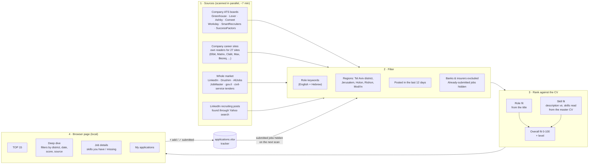

# Job Search

A one-click job-search tool for the Israeli market. It scans 120+ company career boards and the main Israeli job sites, keeps only data/analytics roles in the chosen regions, ranks every posting against the candidate's own CV, and shows the result in a local browser page that writes straight to an Excel application tracker.

## How it works

## Run it

Double-click `START.bat`. It starts a small local server (127.0.0.1 only, no console window), opens the page in the browser and runs a fresh scan with live progress. When the scan ends the page shows the TOP 15; the skill-fit scores fill in over the next few minutes as job descriptions are read in the background.

Requirements: Python 3.12 with `pip install -r TOOL_FILES/engine/requirements.txt`. The interpreter path is set at the top of `START.bat`.

Personal files are not in this repository: the CV (pointed to by `RESUME_INPUT` in `TOOL_FILES/.env`), the `applications.xlsx` tracker, the API key and the scan results all stay on the local machine.

## Code map

| Path | What it does |
|---|---|
| `TOOL_FILES/engine/web_app.py` + `web/index.html` | Local server and the browser page |
| `TOOL_FILES/engine/find_jobs_combined.py` | Runs all sources in parallel, merges, ranks |
| `TOOL_FILES/engine/find_jobs.py` | ATS adapters, role/location/sector filters, tracker matching |
| `TOOL_FILES/engine/company_sites*.py` | Readers for companies' own career sites |
| `TOOL_FILES/engine/market_sources.py`, `israeli_boards.py`, `extra_sources.py` | LinkedIn, Drushim, AllJobs, JobMaster, posts, government sources |
| `TOOL_FILES/engine/personalized_ranking.py` | Role fit from the job title |
| `TOOL_FILES/engine/skill_match.py` | Skill fit: posting text vs. skills found in the CV |
| `TOOL_FILES/engine/tracker.py` | The Excel tracker |
| `TOOL_FILES/engine/tailor_resume.py` | Optional: tailor the CV to one posting with the Claude API |
| `TOOL_FILES/engine/job_search_config.json` | Keywords, regions, companies, exclusions |
